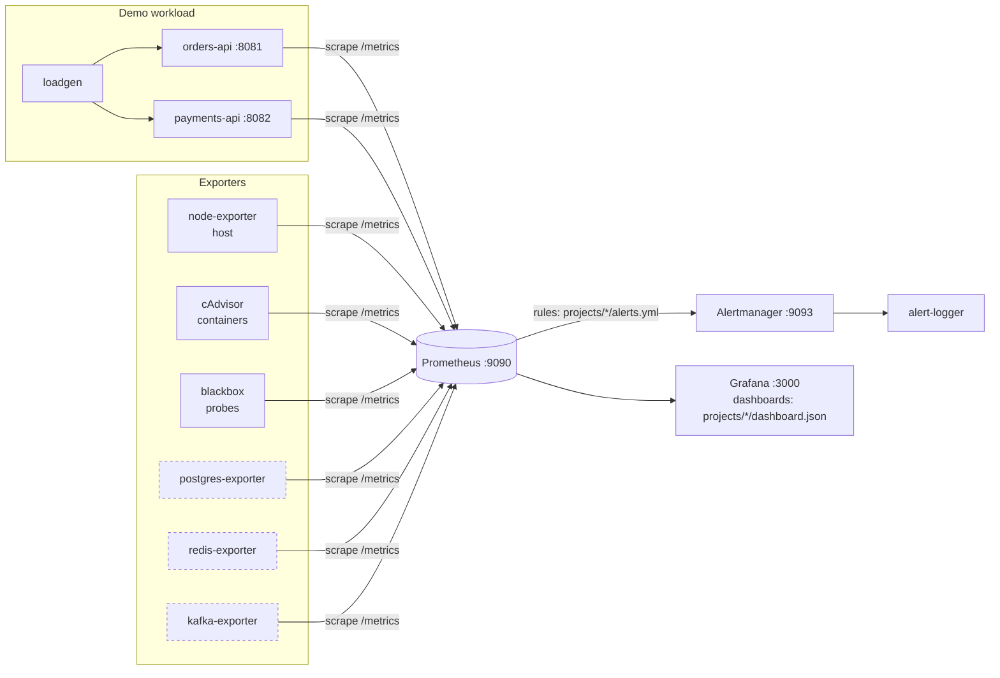

# Observability Lab: 15 Real-World Monitoring Scenarios with Prometheus & Grafana

A hands-on lab that covers the monitoring scenarios teams actually run in production: applications, containers, Kubernetes, hosts, databases, queues, and availability.

Every project ships:

- **Metrics source:** an instrumented app or an exporter
- **Alert rules** with runbook annotations
- **A Grafana dashboard**, auto-provisioned
- **A `trigger.sh`** that *causes* the problem, so you can watch detection end to end
- **A README** covering why it matters, PromQL, alerts, runbook, pitfalls, and exercises

```
┌─────────────── what you break ───────────────┐   ┌──────── what you watch ────────┐
 trigger.sh ──▶ demo app / container / host / DB ──▶ Prometheus ──▶ Alertmanager ──▶ alert-logger
                                                        │
                                                        └────────▶ Grafana dashboards
```

## Contents

1. [The 15 projects](#the-15-projects)
2. [Architecture](#architecture)
3. [Prerequisites](#prerequisites)
4. [Quick start](#quick-start)
5. [Repository layout](#repository-layout)
6. [Conventions](#conventions)
7. [Recommended learning path](#recommended-learning-path)
8. [Troubleshooting](#troubleshooting)
9. [Where to go next](#where-to-go-next)

## The 15 projects

| # | Project | Layer | Method | What you break | Needs |
|---|---|---|---|---|---|
| 01 | [Request rate](projects/01-request-rate/README.md) | App | RED: Rate | Stop or spike traffic | core |
| 02 | [Error rate](projects/02-error-rate/README.md) | App | RED: Errors | Inject 10–35% HTTP 500 | core |
| 03 | [Latency p95/p99](projects/03-latency/README.md) | App | RED: Duration | Inject 600–1500 ms | core |
| 04 | [Runtime health](projects/04-runtime-health/README.md) | App runtime | USE | Memory leak, CPU burn | core |
| 05 | [SLO & error budget](projects/05-slo-error-budget/README.md) | Service | SRE burn rate | Fast and slow budget burn | core |
| 06 | [Container CPU/memory vs limits](projects/06-container-resources/README.md) | Container | USE | Leak until **OOM kill** | core |
| 07 | [CPU throttling](projects/07-cpu-throttling/README.md) | Container | USE: Saturation | Work beyond the CPU limit | core |
| 08 | [Pod restarts / CrashLoop / OOMKilled](projects/08-pod-restarts-crashloop/README.md) | Kubernetes | State | Crashing, OOM, and bad-image pods | **k8s** |
| 09 | [Deployment & replica health](projects/09-deployment-health/README.md) | Kubernetes | State | Bad rollout, Pending pods | **k8s** |
| 10 | [Host CPU, memory, load](projects/10-node-cpu-memory/README.md) | Host | USE | stress-ng CPU and memory | core |
| 11 | [Disk space & I/O](projects/11-disk-space-io/README.md) | Host | USE + prediction | Fill a loopback disk | core (Linux) |
| 12 | [Network](projects/12-network/README.md) | Host / container | USE | iperf3 800 Mbit/s | core |
| 13 | [Databases: PostgreSQL & Redis](projects/13-databases/README.md) | Dependency | USE | Connection flood, long transaction, deadlock, evictions | `make db-on` |
| 14 | [Kafka consumer lag](projects/14-message-queue-lag/README.md) | Dependency | Saturation | Slow or stopped consumer | `make mq-on` |
| 15 | [Availability & probes & TLS](projects/15-availability-probes/README.md) | Outside-in | Black-box | Stop a service, fail a health check | core |

**Totals:** 64 Prometheus alerts, 12 alerting rules for the Kubernetes track, 10 SLO recording rules, and 15 dashboards.

## Architecture



| Component | Role | Port |
|---|---|---|
| **Prometheus** | Scrapes every 15s, evaluates rules, keeps 30 days | 9090 |
| **Alertmanager** | Groups, inhibits, and routes alerts to the webhook `alert-logger` (Slack/email examples included) | 9093 |
| **Grafana** | One folder per project, provisioned from files | 3000 |
| **orders-api / payments-api** | Flask demo services with RED, runtime, and business metrics, plus a **chaos API** | 8081 / 8082 |
| **loadgen** | Constant 10 rps traffic mix, including about 20% 404s | – |
| **node-exporter** | Host metrics (host network, host PID) | 9100 on host |
| **cAdvisor** | Container metrics | internal |
| **blackbox-exporter** | HTTP, TCP, ICMP, DNS, and TLS probes | internal |
| *profile `db`* | Postgres 16 + exporter, Redis 7 + exporter | internal |
| *profile `mq`* | Kafka 3.8 (KRaft) + exporter + producer and consumer | internal |
| *k8s track* | kind + kube-prometheus-stack | 30000 / 30090 |

### The demo app's chaos API

Every scenario is reproducible because the demo apps can misbehave on command:

```bash
curl -X POST "localhost:8081/chaos?error_rate=0.3"      # 30% HTTP 500
curl -X POST "localhost:8081/chaos?latency_ms=800"      # +800 ms (±50% jitter)
curl -X POST "localhost:8081/chaos?healthy=false"       # /healthz -> 503
curl -X POST "localhost:8081/chaos/leak?mb=20"          # leak 20 MB
curl -X POST "localhost:8081/chaos/burn?seconds=120"    # burn CPU beyond the limit
curl -X POST "localhost:8081/chaos/reset"               # back to normal
curl localhost:8081/chaos                               # current state
```

## Prerequisites

| | Minimum | Notes |
|---|---|---|
| Docker Engine + Compose v2 | Docker 20.10+ | `docker compose version` |
| RAM / CPU | 4 GB / 2 cores (core); 8 GB with the `mq` profile | |
| OS | **Linux recommended** | Mac/Windows work, with caveats below |
| make, curl, python3 | any | python3 only for `make dashboards` and `make alerts` |
| k8s track only | kind, kubectl, helm 3 | see [k8s/README.md](k8s/README.md) |

**Docker Desktop (Mac/Windows) caveats**

- node-exporter reports the Docker **VM**, not your laptop (projects 10–12).
- If `rslave` fails, remove `,rslave` from the node-exporter volume in `docker-compose.yml`.
- Project 11's loopback disk needs a Linux host.
- Host networking requires a recent Docker Desktop (4.34+). Without it, project 10–12 host metrics may be missing. Everything else works.

## Quick start

```bash
make up                       # builds demo images, starts 10 containers (~1-2 min first time)
make validate                 # optional: promtool + amtool checks
```

1. Open **Grafana** at http://localhost:3000 (admin / admin), go to **Dashboards**, and pick a project folder.
2. Open **Prometheus** at http://localhost:9090. Check **Status → Targets** (everything should be UP) and **Alerts**.
3. Follow alerts live with `docker logs -f lab-alert-logger`.

Try your first scenario:

```bash
./projects/02-error-rate/trigger.sh critical
make alerts                   # pending -> firing after ~3 minutes
./projects/02-error-rate/trigger.sh reset
```

Optional stacks:

```bash
make db-on    / make db-off   # project 13
make mq-on    / make mq-off   # project 14
make k8s-up   / make k8s-down # projects 08, 09
```

Stop the lab:

```bash
make down     # keep data
make clean    # delete data
```

All targets: `make help`.

## Repository layout

```
observability-lab/
├── docker-compose.yml          # the whole stack (profiles: db, mq)
├── Makefile                    # make help
├── prometheus/
│   ├── prometheus.yml          # scrape jobs + rule_files: /lab/projects/*/alerts.yml
│   └── file_sd/                # optional targets, switched on by make db-on / mq-on
├── alertmanager/alertmanager.yml
├── blackbox/blackbox.yml       # probe modules
├── grafana/provisioning/       # datasource (uid "prometheus") + dashboard provider
├── apps/
│   ├── demo-app/               # Flask service: RED + runtime + business metrics + chaos API
│   ├── loadgen/                # constant-rate traffic
│   ├── alert-logger/           # webhook receiver that prints alerts
│   └── mq-worker/              # Kafka producer/consumer
├── projects/
│   └── NN-name/
│       ├── README.md           # the guide
│       ├── alerts.yml          # Prometheus rules (auto-loaded)
│       ├── recording.yml       # (project 05 only)
│       ├── dashboard.json      # Grafana dashboard (auto-provisioned)
│       └── trigger.sh          # break it / reset it
├── k8s/                        # kind + kube-prometheus-stack, lab PrometheusRule, scenario manifests
└── tools/
    ├── build_dashboards.py     # generates all dashboard.json files
    └── alerts.py               # make alerts
```

## Conventions

**Alert labels**

| Label | Values |
|---|---|
| `severity` | `critical` (page someone), `warning` (look soon), `info` (context) |
| `project` | `"01"` … `"15"`; each dashboard's "Firing alerts" panel filters on it |

**Alert annotations:** `summary` (one line with values), `description` (context and what to check), and `runbook` (a link to the README's runbook section).

**Dashboards:** uid `lab-NN`. A header row with the explanation and a firing-alert counter comes first, then stats, then graphs. Units are always set, and threshold lines match the alert thresholds.

**Metric naming** follows Prometheus best practice: `_total` for counters, `_seconds` and `_bytes` base units, and recording rules as `level:metric:operation`.

**Label hygiene:** no unbounded labels (user IDs, raw URLs). Routes use templates such as `/api/orders/<int:order_id>`.

### Add your own project

1. `mkdir projects/16-my-scenario` and add `alerts.yml` with `project: "16"` labels.
2. Add a dashboard in `tools/build_dashboards.py`, or export one from Grafana into `dashboard.json`.
3. Run `make reload` (Prometheus). Grafana picks up the dashboard within 30s.

## Recommended learning path

| Day | Projects | Goal |
|---|---|---|
| 1 | 01 → 02 → 03 | RED method, counters vs histograms, `rate()`, `histogram_quantile()` |
| 2 | 04 → 06 → 07 | Runtime and container resources, OOM and throttling |
| 3 | 10 → 11 → 12 → 15 | USE method, predictive alerts, black-box monitoring |
| 4 | 13 → 14 | Dependencies and exporters |
| 5 | 08 → 09 | Kubernetes state with kube-state-metrics |
| 6 | 05 | SLOs and burn-rate alerting, the capstone that ties everything together |

## Troubleshooting

| Symptom | Fix |
|---|---|
| `node` target DOWN | A host firewall blocks container → host:9100. Allow the Docker bridge (`sudo ufw allow from 172.16.0.0/12 to any port 9100`) or check that Docker supports `host-gateway`. |
| cAdvisor has no `lab-*` containers | Some distros need `/var/lib/docker` in a different location, or cgroup v2 support. Check `docker logs lab-cadvisor`. |
| `TrafficDrop` never fires | It needs 30 minutes of history first. |
| `SSLCertExpired` is firing | Intentional: it's `expired.badssl.com`. |
| External probes fail (example.com, 1.1.1.1) | No internet from Docker, or ICMP is blocked. |
| Port already in use | Change the left side of `ports:` in `docker-compose.yml`. |
| An image tag isn't found | Tags are pinned; bump to a current version on Docker Hub, Quay, or GCR. |
| Dashboard shows "No data" | Check the time range (last 30m), target health, and that the metric exists in Prometheus → Graph. Projects 08/09 need the k8s track; 13/14 need `db-on` / `mq-on`. |
| Changed an alert and nothing happens | Run `make reload`, then `make validate` to find syntax errors. |

## Where to go next

- **Logs:** Loki + Promtail/Alloy, then jump from a Grafana panel to the logs of the same time range.
- **Traces:** OpenTelemetry + Tempo, with exemplars linking a latency spike to a single slow trace.
- **Native histograms** (Prometheus 3): no more bucket tuning.
- **SLO generators:** Sloth or Pyrra produce project 05's rules from a 10-line spec.
- **Long-term storage & HA:** Thanos or Mimir.
- **Alert quality:** track how many alerts led to action, and delete the rest.
